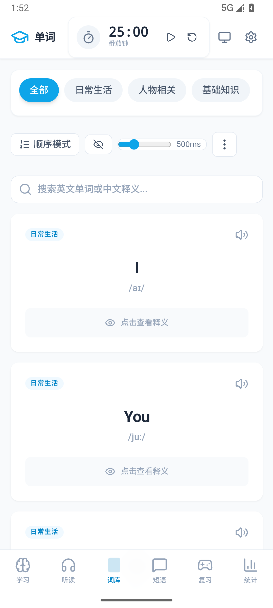
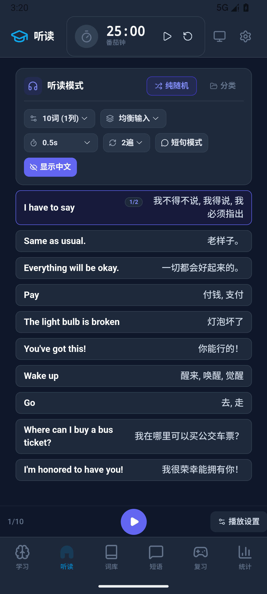
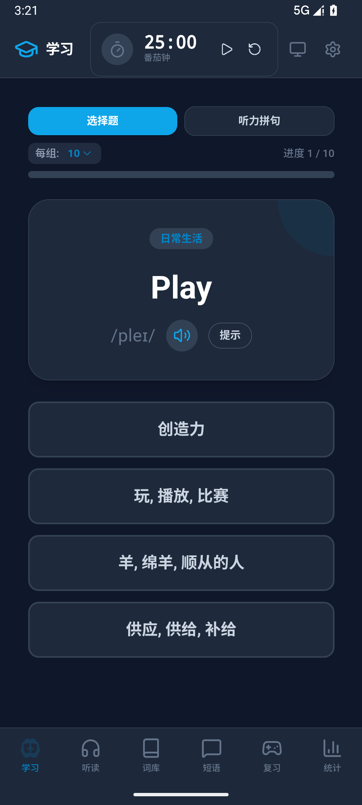
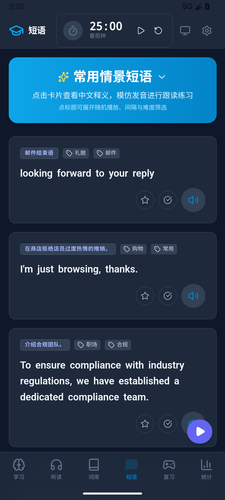
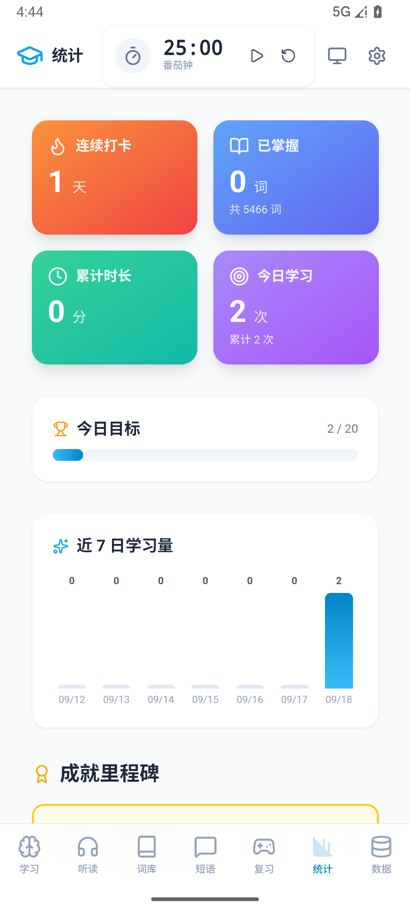
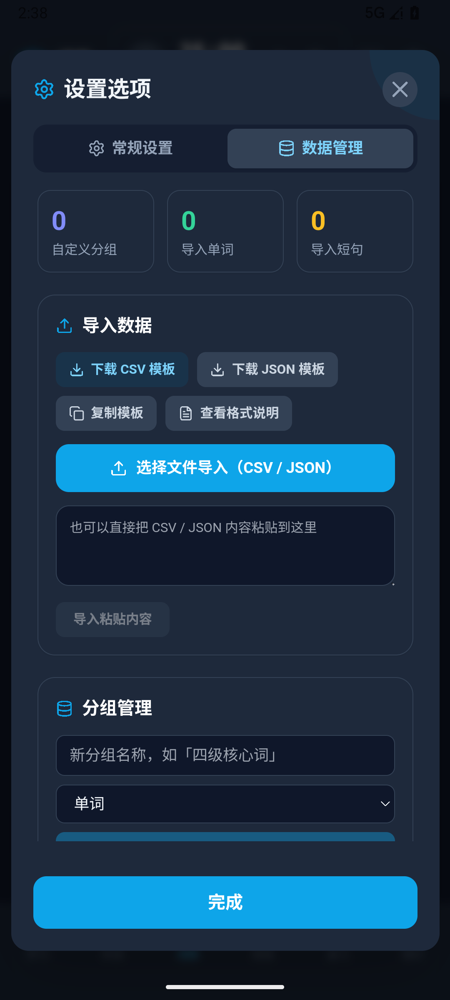
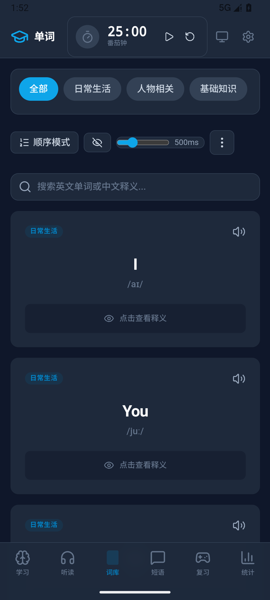
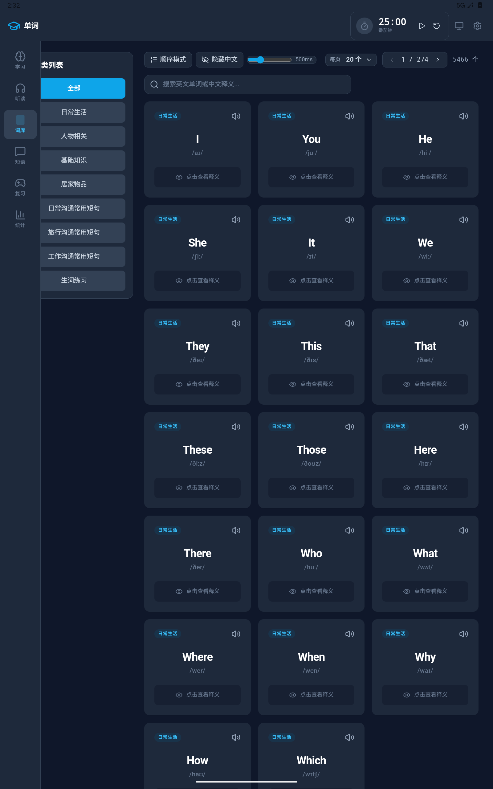
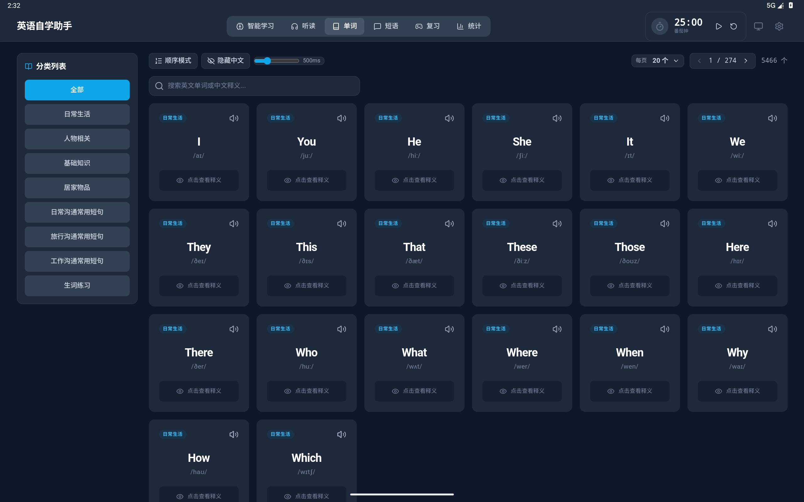

# LinguaLeap 英语自学助手

一款离线优先的英语自学应用：**单词、短语、听力、智能复习、学习统计**一体化，
既能在浏览器 / PWA 里用，也能打包成 **Android APK** 装到手机和平板上。

内置 5,400+ 单词与 3,700+ 常用短句，配合语音合成（TTS）实现「听、说、读、记」闭环。
所有学习数据保存在本机，不联网、不上传。


---

## 📱 界面预览

| 词库 | 听读 | 智能学习 |
| --- | --- | --- |
|  |  |  |

| 短语（面板可折叠） | 学习统计 | 数据导入 |
| --- | --- | --- |
|  |  |  |

| 深色模式 | 平板竖屏 | 2K 大屏 |
| --- | --- | --- |
|  |  |  |

更多截图见 [`docs/screenshots/`](docs/screenshots)。

---

## ✨ 功能特性

### 单词学习（词库）

- **7 大分类**：日常生活、人物相关、基础知识、居家物品、日常沟通 / 旅行沟通 / 工作沟通常用短句
- 分类筛选、**生词练习**（自动过滤已学单词）、自定义导入分组同样可作为筛选项
- **顺序 / 随机**两种浏览模式，随机模式支持一键重新洗牌
- 智能搜索：英文单词与中文释义的**模糊匹配 + 相关度排序**
- 点卡片即发音，支持**慢速逐词播放**；中文释义可逐个揭示或全局开关
- 分页浏览、加载更多、每页数量自定义（20 / 50 / 100）

### 短语跟读（短句）

- 3,700+ 常用短句，按长度自动分级（短句 / 中句 / 长句）
- **连续跟读**：播放范围（当前页 / 已加载 / 全部 / 收藏）×
  播放模式（英文循环 / 英-中-英 / 中-英 / 仅英文）× 间隔与重复次数
- 点句中生词**即时查词**，支持词形还原（复数、进行时、过去式、比较级等）
- **收藏**与**已掌握**标记，收藏夹可单独练习
- 顶部操作面板在手机上默认折叠，平板 / 桌面默认展开，选择会被记住

### 智能学习（SRS 间隔重复）

- 基于 **SuperMemo-2** 算法安排复习：到期单词自动进入队列，新词按量补充
- **选择题模式**：四选一，答错可继续尝试，内置「排除干扰项」提示
- 键盘快捷键：`空格` 发音、`1-4` 选择、`H` 提示
- **听力拼句模式**：听音逐词拼出完整句子（多邻国风格），最多播放 3 次，支持撤销 / 清空 / 逐词慢放
- 难度筛选与每组数量可调（5 / 10 / 20 / 30）

### 听力训练（听读）

- **随机 / 分类**两种模式；批次大小、重复次数、播放间隔、播放策略（专注 / 均衡 / 探索）可调
- 可开启**自动切换批次**与**定时自动关闭**（配合番茄钟）
- 朗读高亮跟随、点击任意单词即时查看释义

### 游戏复习

- **连连看**：英文 ↔ 中文配对，答对绘制连线并计分，全部配对即通关

### 学习统计

- **连续打卡天数**、**已掌握单词数**（由 SRS 进度实时统计）、**累计学习时长**、**今日 / 累计练习次数**
- **今日目标进度条**与**近 7 日学习量柱状图**
- 成就里程碑：初出茅庐、持之以恒、词汇达人、专注大师
- 常驻**番茄钟**，自动累计学习时长

### 数据导入与自定义分组

- 按模板导入自己的**单词 / 短句**（CSV 或 JSON），支持选文件或直接粘贴
- 自动建分组、同组内按英文去重、逐行校验并报出错行号
- 分组可新建 / 重命名 / 删除，可展开查看与删除单条数据
- 导入内容会立即并入词库、听读、短语、复习、智能学习五个模块，并出现在词库的分类筛选里

### 状态恢复与个性化

- **关掉应用再打开会回到上次的页面与进度**：听读/学习的批次与位置、词库与短语的筛选和页码都会保留
- 深色模式（自动 / 浅色 / 深色）、字体缩放（80%–120%）
- 语音设置：英文 / 中文发音人、语速、音量，可即时试听

---

## 🖥 平台支持

| 平台 | 说明 |
| --- | --- |
| 桌面浏览器 | `npm run dev` 直接开发调试；`npm run build` 产物可部署到任意静态托管 |
| PWA | 支持「添加到主屏幕」，离线可用（Service Worker 预缓存） |
| Android App | 见下文《Android 打包》，产出可安装的 APK |

应用会根据视口宽度自动切换三种形态，也可在设置里手动锁定：

- **手机**：底部标签栏 + 全屏沉浸布局
- **平板**：左侧竖向导航 + 内容铺满
- **桌面 / 2K 大屏**：顶部横向导航 + 多列卡片（最高 6 列）

---

## 🛠 技术栈

| 分类 | 技术 |
| --- | --- |
| 框架 | React 19 + TypeScript 5.8 |
| 构建 | Vite 5 + vite-plugin-pwa |
| 样式 | Tailwind CSS 3（自定义 `brand` 色板）+ lucide-react 图标 |
| 语音 | Web Speech API；Android 端由自研原生 TTS 插件接管（见下） |
| 存储 | localStorage（进度 / 设置 / 统计 / 导入数据 / 会话状态） |
| 算法 | SuperMemo-2 间隔重复（`services/srs.ts` 自研实现） |
| 移动端 | Capacitor 7 + Android 原生插件（Java） |

---

## 🚀 快速开始（Web）

**环境要求：** Node.js 18+

```bash
npm install      # 安装依赖
npm run dev      # 启动开发服务器（默认 http://localhost:5173）
npm run build    # 生产构建，产物在 dist/
npm run preview  # 本地预览构建产物
```

### 数据维护脚本

```bash
npm run clean:vocabulary            # 词库去重
npm run generate:vocabulary-tiers   # 生成难度分级词库
```

---

## 🤖 Android 打包

### 环境要求

| 依赖 | 版本 |
| --- | --- |
| JDK | **21**（Capacitor 7 要求，17 会构建失败） |
| Android SDK | 含 platform-tools / build-tools |
| Node.js | 18+ |

在 `android/local.properties` 里指定 SDK 路径（该文件不入库）：

```properties
sdk.dir=C\:\\Android\\Sdk
```

> 项目路径含中文时，`android/gradle.properties` 中需要保留
> `android.overridePathCheck=true`（仓库里已配置好）。

### 一条命令打包

```bash
npm run android:apk       # debug 包  → release/lingualeap-1.0.0-debug.apk
npm run android:release   # release 包 → release/lingualeap-1.0.0-release.apk
```

脚本（`scripts/build-apk.mjs`）会依次执行：
清空 `dist` → `vite build` → 用 `robocopy /MIR` 把产物同步进原生工程 →
生成图标与启动图 → `gradlew assembleRelease` → 拷贝到 `release/`。

构建末尾会**校验资源确实进了原生工程**（比对两边的 JS 产物名），不一致直接中止 ——
避免出现「构建成功但包里还是旧前端」这种静默失败。

### 安装到设备

```bash
adb install -r release/lingualeap-1.0.0-release.apk
```

### 签名配置

签名信息从 `android/keystore.properties` 读取，**该文件与证书本体都不入库**：

```properties
# android/keystore.properties —— 需自行创建
storeFile     = my-release.jks      # 相对 android/app/ 的路径
storePassword = <你的证书口令>
keyAlias      = <你的别名>
keyPassword   = <你的口令>
```

- 没有这个文件时，release 会自动退回 debug 签名，`assembleRelease` 仍能跑通，
  但产出的包无法覆盖安装其他签名的版本。
- 生成自己的证书：

  ```bash
  keytool -genkeypair -v -keystore android/app/my-release.jks \
    -alias myalias -keyalg RSA -keysize 2048 -validity 36500
  ```

### Android 端的特殊处理

WebView 与浏览器有不少差异，项目为此做了针对性适配（详见
[`docs/Android打包与适配说明.md`](docs/Android打包与适配说明.md)）：

- **原生 TTS 插件**（`NativeTtsPlugin`）：Android WebView 不提供 `speechSynthesis`，
  用系统 TTS 实现了一套兼容 W3C 语音合成接口的桥接层；事件按 `utteranceId` 关联，
  否则会出现「连播只播第一条」。
- **文件导出插件**（`FileExportPlugin`）：WebView 不处理 `<a download>`，
  模板下载改走系统「保存到…」选择器（SAF，无需存储权限）。
- **系统栏适配**（`SystemUiPlugin`）：Android 15 起强制边到边，
  由原生读出状态栏 / 导航栏 / 刘海尺寸，注入 CSS 变量供布局使用。
- 页面内的悬浮按钮、播放条都基于 `--bottom-nav-h` 等 CSS 变量定位，不会压到底部标签栏。

---

## 📥 数据导入模板

把模板里的示例行改成自己的内容即可导入（CSV 或 JSON 都支持）。

**CSV**（第一行必须是表头，中英文列名都认）：

```csv
类型,英文,中文,音标,分类/情景,标签,分组
单词,apple,苹果,/ˈæpl/,基础知识,水果,我的词库
单词,airport,机场,/ˈerpɔːrt/,旅行沟通常用短句,交通,我的词库
短句,How much is this?,这个多少钱？,,日常沟通常用短句,购物,我的句库
```

**JSON**：

```json
[
  {
    "type": "word",
    "english": "apple",
    "chinese": "苹果",
    "pronunciation": "/ˈæpl/",
    "category": "基础知识",
    "tags": ["水果"],
    "group": "我的词库"
  }
]
```

| 字段 | 必填 | 说明 |
| --- | --- | --- |
| 类型 / type | 否 | `单词` / `word`（默认）或 `短句` / `phrase` |
| 英文 / english | **是** | 单词或句子原文 |
| 中文 / chinese | **是** | 释义或译文 |
| 音标 / pronunciation | 否 | IPA，例如 `/ˈæpl/` |
| 分类 / 情景 / category | 否 | 填 7 大分类之一，或自定义文本 |
| 标签 / tags | 否 | 多个用分号 `;` 分隔 |
| 分组 / group | 否 | 目标分组名，不存在会自动创建；留空则按当天日期建组 |

导入入口：**设置 → 数据管理**（可下载模板、复制模板、选文件或粘贴导入）。

---

## 📁 项目结构

```
├── App.tsx                      # 主框架：视图路由 / 主题 / 三种布局形态
├── index.tsx                    # 渲染入口（首行导入原生能力桥接）
├── types.ts                     # 全局类型定义
├── components/
│   ├── VocabularyView.tsx       # 单词学习
│   ├── PhrasesView.tsx          # 短语跟读
│   ├── StudySession.tsx         # 智能学习（选择题 + 听力拼句）
│   ├── ListenView.tsx           # 听力训练（听读）
│   ├── GameView.tsx             # 连连看复习
│   ├── StatisticsPanel.tsx      # 学习统计
│   ├── SettingsPanel.tsx        # 设置（常规设置 / 数据管理）
│   ├── DataManager.tsx          # 数据导入与自定义分组
│   └── PomodoroTimer.tsx        # 番茄钟
├── services/
│   ├── srs.ts                   # SuperMemo-2 间隔重复算法
│   ├── storage.ts               # 进度 / 统计 / 设置的本地持久化
│   ├── session.ts               # 会话状态（页面与学习进度恢复）
│   ├── customData.ts            # 导入数据与分组管理
│   ├── importService.ts         # CSV / JSON 解析与模板
│   ├── ttsService.ts            # 语音合成服务（含慢速逐词）
│   └── wordChecker.ts           # 词库完整性检查
├── src/
│   ├── ttsBridge.ts             # Android 原生 TTS ↔ Web Speech API 桥接
│   ├── native.ts                # 原生能力（系统栏尺寸等）
│   └── index.css                # 全局样式与布局变量
├── data/
│   ├── vocabulary.ts            # 单词词库
│   ├── phrases.ts               # 常用短句库
│   └── vocabularyTiers.ts       # 词库难度分级
├── android/                     # Capacitor 原生工程（含 3 个自研 Java 插件）
├── docs/                        # 使用与打包文档、界面截图
└── scripts/                     # 构建、词库维护、界面自检脚本
```

---

## 📊 数据规模

| 数据 | 数量 |
| --- | --- |
| 单词条目 | 5,466 |
| 常用短句 | 3,795 |
| 内置分类 | 7 大类 |

> 导入的自定义数据会与内置数据合并使用，数量不限。

---

## 🔒 数据与隐私

- 学习进度、统计、设置、导入数据**全部保存在本机 localStorage**，不上传任何服务器
- 应用本身可离线运行（PWA 预缓存 / APK 内置资源）
- 语音朗读使用系统 TTS 引擎，不依赖在线服务
- 仓库内不包含签名证书与口令

---

## ❓ 常见问题

**Q：构建时报「Your project path contains non-ASCII characters」**
保持 `android/gradle.properties` 里的 `android.overridePathCheck=true`。

**Q：Gradle 下载依赖卡住**
`android/build.gradle` 中已把仓库换为国内镜像，若仍卡住请检查网络或代理。

**Q：Android 上点「下载模板」没反应**
现在会弹出系统的「保存到…」对话框，选择位置后即可保存到本地（默认 Downloads）。

**Q：听读连播只播第一条**
原生 TTS 的事件必须按 `utteranceId` 过滤，否则上一条的中断事件会被当成新语句结束。
本项目已在 `src/ttsBridge.ts` 处理，二次开发时注意保留该逻辑。

**Q：升级安装后界面还是旧的**
Android 覆盖安装后 WebView 可能仍持有旧缓存，验证时先 `adb shell pm clear com.lingualeap.app`。

---

## 📄 许可证

本项目基于 [木兰宽松许可证，第 2 版（Mulan PSL v2）](LICENSE) 开源。
